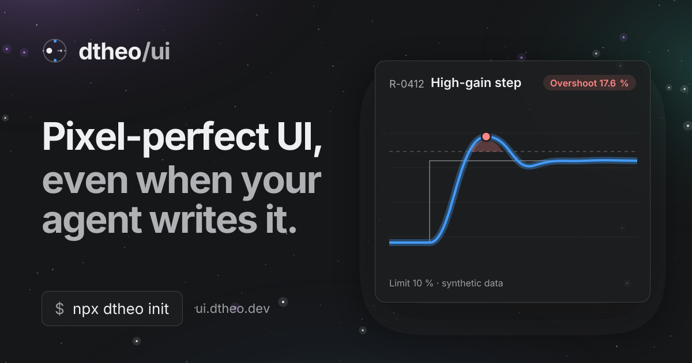

<p align="center">
  <a href="https://ui.dtheo.dev"></a>
</p>

<h1 align="center">dtheo/ui</h1>

<p align="center">
  Build clean UIs with your coding agent: React components and tokens,<br />
  with an MCP server and a design linter built in.
</p>

<p align="center">
  <a href="https://ui.dtheo.dev"><strong>ui.dtheo.dev</strong></a> ·
  <a href="https://ui.dtheo.dev/docs/components">Components</a> ·
  <a href="https://ui.dtheo.dev/docs/agents">For agents</a> ·
  <a href="https://ui.dtheo.dev/docs/how-it-works">How it works</a>
</p>

<p align="center">
  <a href="https://github.com/DimitrisTheo-Dev/dtheo-ui/actions/workflows/product-quality.yml"></a>
  <a href="https://github.com/DimitrisTheo-Dev/dtheo-ui/actions/workflows/ci.yml"></a>
  <a href="https://www.npmjs.com/package/dtheo"></a>
  <a href="LICENSE"></a>
</p>

---

## Start

```bash
npx dtheo init
npx dtheo add button table line-chart
npx dtheo check
```

`init` offers to delete the starter styles that override the theme, and `add` prints the packages to
install; the [installation guide](https://ui.dtheo.dev/docs/installation) has every step. Components
are copied into your project, so you own the code. Every item also installs with the shadcn CLI.

## With a coding agent

The agent looks a component up before using it, writes the screen, then runs `dtheo check` and
fixes each finding from its line and suggested fix.

```bash
claude mcp add --transport http dtheo https://ui.dtheo.dev/mcp
```

In Claude Code, the [dtheo plugin](https://github.com/DimitrisTheo-Dev/agent-skills) adds the same
server plus skills that plan, design and review the screen:

```text
/plugin marketplace add DimitrisTheo-Dev/agent-skills
/plugin install dtheo@dtheo
```

## What is inside

- **38 components** on Base UI and Tailwind CSS v4, including a virtualized data table.
- **22 design checks** in `dtheo check`, each with the line and the fix. It exits 1 in CI.
- **Contrast measured on every build:** 43 color pairs in Graphite and Carbon, light and dark.
- **8 charts** for dashboards. They draw limits and read with the arrow keys.
- A **Figma library** built from the tokens, and **5 example apps** on synthetic data.

## How it is built

```
packages/tokens   One OKLCH source: CSS, DTCG JSON, React Native values, contrast report
packages/ui       Components on Base UI, and the contracts that drive docs, registry and MCP
packages/charts   SVG via React, canvas for live and dense data, d3 for the math
packages/cli      dtheo: copies components from the registry and runs the design check
packages/figma    A Figma plugin that builds the library from the token build
apps/docs         ui.dtheo.dev: docs, examples, registry, MCP server, llms.txt
e2e               Playwright: every route at two widths, axe on 20 routes, pixels
```

Every pull request runs through
[product-engineering-quality-gate](https://github.com/DimitrisTheo-Dev/product-engineering-quality-gate)
([checks](quality-gate.config.json)). To work on it, start with [AGENTS.md](AGENTS.md).

## License

[MIT](LICENSE) © Dimitris Theodoropoulos
